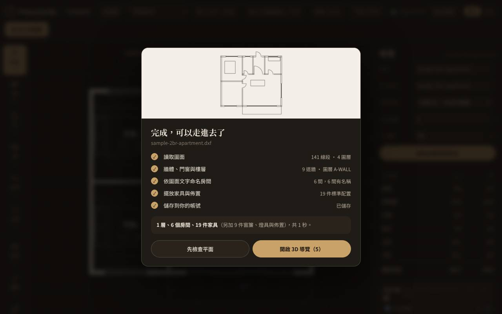
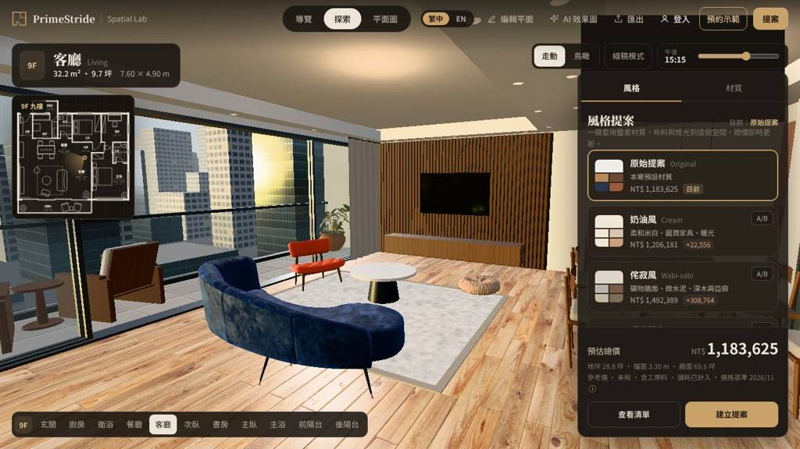
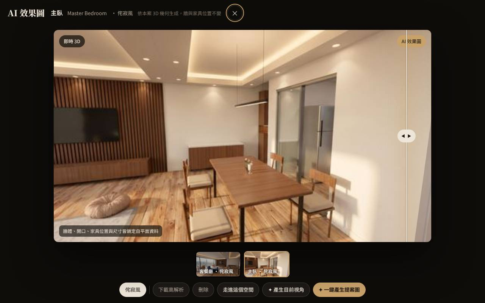
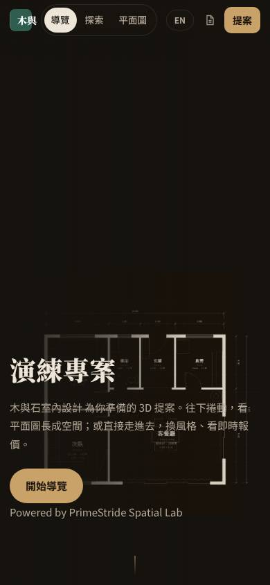
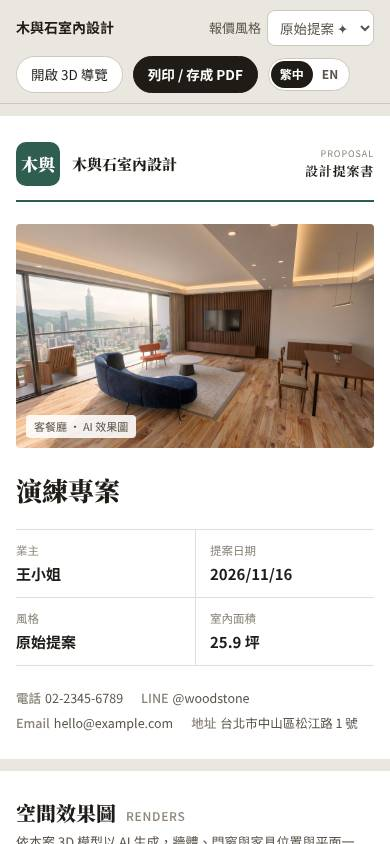

# 示範演練紀錄（T-007）

2026-11-16，本機（`qa/rehearse.mjs`，headless Chrome，1280×800）。雲端與 AI 用模擬：房間辨識重播
`qa/recordings/591-A3.json`（每次 0.3 秒），效果圖每張 1.5 秒回傳示範宅的圖。**沒有呼叫任何付費 AI。**
腳本：[`demo.md`](demo.md)。

重跑方式（示範前一天用客戶的圖）：

```
npm --prefix qa run rehearse -- 591-A3 dxf-d00-own-apartment dwg-acadsharp-sample-ac1032   # 預設三張
npm --prefix qa run rehearse -- ~/Desktop/王公館-平面.dwg                                  # 任何檔案
```

截圖與 `rehearsal.json` 寫到 `qa/reports/rehearsal/`（不進 git：可能是第三方或客戶的圖）。

## 各步驟時間（秒）

| 平面圖 | 類型 | 匯入（上傳→進度完成） | 開啟 3D | 換風格* | ✦ 一鍵提案圖* | 分享連結（手機） | 提案書 | 錯誤 |
|---|---|---|---|---|---|---|---|---|
| 591-A3（3 層透天） | 圖片，AI 重播 | 2.2 | 1.7 | 18.7 | 44.5（2 張） | 1.9 | 1.0 | 0 |
| d00 公寓 | DXF | 1.8 | 1.9 | 32.9 | 68.8（2 張） | 2.0 | 0.8 | 0 |
| ACadSharp AC1032 | DWG（AutoCAD 2018 格式） | 4.0（含轉檔） | 2.2 | 20.2 | 29.3（1 張） | 1.6 | 0.6 | 0 |
| 我們的範例 2 房 | DXF（repo 內） | 1.4 | 1.7 | 30.8 | 60.1（2 張） | 1.4 | 0.8 | 0 |

\* 換風格與拍攝視角是 **3D 繪圖**：這台機器沒有 GPU（軟體繪圖，一格 0.4–8.6 秒，而且同時有其他測試在跑），
這兩欄只代表「功能正常」，不代表筆電上的速度。筆電 GPU 上換風格是約 1.1 秒的掃過動畫，每個視角拍攝不到 1 秒。
匯入、開 3D、分享、提案書主要是 CPU 工作，數字可信。

**結果與房間**
- 591-A3：3 層、10 間（客餐廳、主臥 ×2、次臥 ×2、衛浴 ×3、主浴、樓梯）242.5 m²，53 件家具＋17 件佈置；檢查 22 項。
  報價 原始提案 NT$1,985,259 → 侘寂風 NT$2,761,439（未稅）。提案書 含稅 NT$2,084,522，10 間。
- d00 公寓 DXF：1 層 7 間（書房、主浴、主臥、客廳、次臥、衛浴、廚房）101.4 m²，24 件家具；檢查 3 項。NT$907,937 → 1,232,688。
- AC1032 DWG：1 層 **2 間（客廳、房間 1）296.9 m²**，11 件家具；檢查 14 項。只拍得到 1 張效果圖（沒有臥室名稱）。
- 範例 DXF：1 層 6 間（廚房、客餐廳、玄關、衛浴、主臥、次臥）85.7 m²，19 件家具。

## 上傳到第一張效果圖：< 2 分鐘 ✓（估計）

正式站多出的時間用 App 自己的估計：AI 認房間 20–40 秒（取 30）、效果圖 30–40 秒（取 35，三張並行）。
加上上表的匯入與開 3D，換風格 1.5 秒、每個視角 1 秒（筆電 GPU）：

| 平面圖 | 估計：上傳 → 第一批效果圖 |
|---|---|
| 591-A3（圖片） | **約 72 秒** |
| d00 公寓 DXF | 約 42 秒 |
| AC1032 DWG | 約 44 秒 |
| 範例 DXF | 約 42 秒 |

這是**機器時間**；示範時中間會走 3D、講風格與報價，實際到出圖大約在第 8 分鐘（見腳本）。
真實延遲沒有量（要花錢，未經同意不呼叫 AI）：示範前用備用專案按一次「✦ 產生目前視角」（NT$4）就是實測。
Vercel 函式上限 60 秒；超過會顯示「AI 這次太久沒有回應，請再按一次」。

## 截圖（只用我們自己的範例 DXF 與示範宅）

| | |
|---|---|
|  進度畫面：範例 DXF，1 秒完成 |  探索＋風格＋報價（示範宅） |
|  ✦ 一鍵產生提案圖（AI 用示範宅的圖模擬） |  客戶手機上的分享連結（設計公司品牌） |
|  提案書（手機） | |

## 已知弱點與現場避免方式

| 弱點 | 影響 | 現場怎麼避免 |
|---|---|---|
| **我們沒有任何真實台灣設計公司的 DWG**（測試的都是國外範例或合成檔；LibreDWG 範例算出 520 萬 m²，單位會錯） | 客戶的 DWG 在台上可能第一次被看到就出錯 | 示範前拿到客戶的圖並演練（T-013）；台上只上傳**演練過**的圖，或直接用備用專案 |
| 房間名稱來自圖面文字；DWG 沒有中文房名時只會出現「客廳、房間 1」 | 3D 房間按鈕和效果圖標題很空；一鍵提案圖只拍到 1 張 | 備用專案先改好房名；台上若出現「房間 1」，說「名稱可以直接點改」 |
| 檢查項目多（591-A3 有 22 項） | 打開「檢查」會像錯很多 | 不主動打開；需要時按「全部補上」 |
| 一鍵提案圖最多 3 張（客／餐／主臥），沒有獨立餐廳時只有 2 張 | 期待 3 張卻只有 2 張 | 說「客廳和主臥兩張」；要更多就在 3D 走到角度按「✦ 產生目前視角」 |
| 設計師選的風格**沒有存到專案**（T-011） | 客戶手機打開分享連結是「原始提案」，總價和剛剛看到的不同 | 請客戶在手機上點同一個風格：「您自己也可以換」；提案書預設是效果圖最多的那個風格 |
| 分享只能在「我的專案」做，沒有 QR code（T-010） | 要離開 3D、複製、用 LINE 傳 | 事先把客戶加 LINE；或提前把備用專案的連結傳好 |
| 登入過期時打開專案會跳回示範宅 | 很尷尬 | 開場前確認右上是「我的專案」 |
| 筆電用電池、或分頁太多 | 3D 降畫質、卡頓 | 接電源、關分頁；必要時 `?q=med` |
| 只有軟體繪圖的截圖裡，右側面板上方有一塊深色區域 | 不確定筆電上是否也有 | 示範前在筆電上看一次探索畫面（交給 T-009 視覺 QA） |

## 演練中修掉的問題（本分支）
1. 風格、材質、核准章是**所有雲端專案共用**同一組瀏覽器設定：準備備用專案時選的風格與「已核准」會出現在客戶剛上傳的新專案。已改成每個專案分開記。
2. 斷網時效果圖顯示英文「Failed to fetch」、逾時顯示「生成失敗：504」：改成中文並說明下一步。
3. 效果圖狀態列過長會跑出畫面：改成可換行。
4. DXF 匯入很快時顯示「共 0 秒」：改成「不到 1 秒」。

---

## English summary

Rehearsed the full demo journey locally on 4 plans (591-A3 picture with recorded AI, d00 apartment DXF, AC1032 DWG,
our sample DXF) with cloud and AI stubbed: **0 errors**. CPU-bound steps: import 1.4–4.0 s, open 3D 1.7–2.2 s, share
link 1.4–2.0 s, 提案書 0.6–1.0 s. Style switch and render captures are GPU work and only prove function on this
GPU-less box. Adding the app's own AI estimates (rooms ≈30 s, renders ≈35 s), upload → first renders is ≈42–44 s for
CAD and ≈72 s for a picture plan: **under the 2-minute target** (estimate; one paid render on the backup project
confirms it live). Biggest risk: no real Taiwan firm DWG has been through the pipeline yet (T-013). Other weak spots
(generic room names, 22 檢查 items, style not saved for the client link, no in-viewer share/QR, expired sign-in) each
have an on-stage workaround in `docs/demo.md`. Four rough edges were fixed in this branch (per-project style/approval,
clear render error messages, wrapping status, "不到 1 秒"). Committed screenshots show only our sample DXF and demo
apartment; fixture screenshots stay in git-ignored `qa/reports/rehearsal/`.
